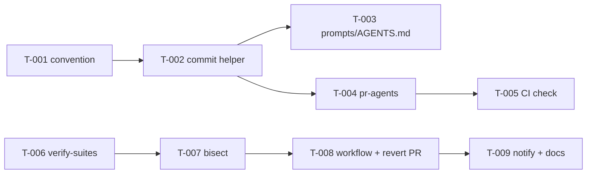

# Tasks: Agent-Provenance & Post-Merge-Verify · aus `04-requirements.md` v0.1

Version: 0.1 · Date: 2026-10-21 · Status: draft · Owner: Jens Holze

## Changelog
| Version | Datum | Änderung |
|---|---|---|
| 0.1 | 2026-10-21 | Erster Task-Schnitt (9 Tasks) |

Status: Entwurf zur Freigabe durch Jens. Es werden **keine** Issues angelegt, bevor Jens zustimmt. Labels je Task: `spec:agent-provenance-verify`, `type:feature|chore|test`, `agent-ready`. Ticket-Texte und ACs auf Englisch (Regel: Tickets immer Englisch).

## Arbeitsweise (gilt für jeden Task)
- Branch von `main`, PR-Base `main` (Ausnahme: keine). Nie Upstream pushen.
- Coder-Wahl und Review-Matrix nach `agents/lead/config.yaml`. Alle Tasks sind Server/CI ohne UI → **Review-Modus `prototyping`** (schneller Durchlauf: ein Fremd-Vendor-Review + `omnigent-reviewer`), außer T-008 (Workflow mit Schreibrechten) → `standard` (Double Review, „larger“).
- Nur self-hosted Runner `[self-hosted, macOS, ARM64, omnigent-ci]`.
- Workflows nie auf `main`/`epic/**` pushen lassen; kein Deploy.

## Waves
| Wave | Tasks |
|---|---|
| 1 | T-001 [P], T-006 [P] |
| 2 | T-002, T-007 |
| 3 | T-003 [P], T-004 [P], T-008 |
| 4 | T-005, T-009 |

## Task-Liste
| # | ID | Title | Depends on | Coder | Review mode | Traces |
|---|---|---|---|---|---|---|
| 1 | T-001 | Document agent provenance trailer convention | – | coder_deepseek | prototyping | FR-001 |
| 2 | T-002 | Add `scripts/fork/agent-commit.sh` helper with validation | T-001 | coder_deepseek | prototyping | FR-002, FR-003, AC-001, AC-002 |
| 3 | T-003 | Wire helper into lead/devops/ux-builder prompts and AGENTS.md | T-002 | coder | prototyping | FR-004, FR-005, AC-013 |
| 4 | T-004 | Add `scripts/fork/pr-agents.sh` PR body generator | T-002 | coder_deepseek | prototyping | FR-006, AC-003 |
| 5 | T-005 | Add `agent-provenance` job to Fork CI (warn/fail) | T-004 | coder_deepseek | prototyping | FR-007–FR-009, AC-004, AC-005 |
| 6 | T-006 | Extract blocking suites into `scripts/fork/verify-suites.sh` | – | coder_deepseek | prototyping | FR-021 |
| 7 | T-007 | Add `scripts/fork/verify-bisect.sh` (rerun once, first-parent bisect) | T-006 | coder | prototyping | FR-022–FR-025, AC-007, AC-008, AC-010 |
| 8 | T-008 | Add `post-merge-verify.yml` with revert-PR creation | T-007 | coder | standard (larger) | FR-020, FR-026, FR-027, FR-029–FR-031, NFR-001/002, AC-006, AC-009, AC-012 |
| 9 | T-009 | Hook notify-spec webhook and write runbook | T-008, Q-3 | coder_deepseek | prototyping | FR-028, NFR-007, AC-011 |

## Tickets

### T-001 — Document agent provenance trailer convention
Labels: `type:chore` · Coder: coder_deepseek · Review: prototyping · Depends: –
**Context:** Agent commits carry no agent/session/model info today.
**Scope:** Create `docs/fork/agent-provenance.md` defining required trailers `Omnigent-Agent`, `Omnigent-Session` (32-hex), `Model`, optional `Omnigent-Task`; exemptions (human, merge, `sync/upstream-*`).
**Acceptance:**
- [ ] `rg -n 'Omnigent-Agent|Omnigent-Session|Model:' docs/fork/agent-provenance.md` — all three trailers documented with one example each.
- [ ] `rg -n 'sync/upstream' docs/fork/agent-provenance.md` — exemptions listed.

### T-002 — Add agent commit helper with validation
Labels: `type:feature` · Coder: coder_deepseek · Review: prototyping · Depends: T-001
**Scope:** `scripts/fork/agent-commit.sh` wraps `git commit`, appends trailers via `git interpret-trailers` from `OMNIGENT_AGENT`, `OMNIGENT_SESSION_ID`, `OMNIGENT_MODEL` or `--agent/--session/--model`. Refuses on missing/invalid values. Tests in `tests/fork/test_agent_commit.py` using a temp git repo.
**Acceptance:**
- [ ] `uv run pytest tests/fork/test_agent_commit.py -q` — passes; covers AC-001 (trailers present) and AC-002 (exit ≠ 0, HEAD unchanged).
- [ ] `shellcheck scripts/fork/agent-commit.sh` — no findings.

### T-003 — Wire helper into agent prompts and AGENTS.md
Labels: `type:chore` · Coder: coder · Review: prototyping · Depends: T-002
**Scope:** Lead brief/HANDOFF gains `Agent/Session/Model` lines; `devops` and `ux-builder` commit only via the helper; fork section of `AGENTS.md` states the rule (incl. Cursor cloud agents). Fork-only sections only.
**Acceptance:**
- [ ] `rg -n 'agent-commit.sh' AGENTS.md agents/lead/config.yaml agents/lead/agents/devops/config.yaml` — at least one hit per file.
- [ ] `rg -n 'Session:' agents/lead/config.yaml` — HANDOFF template contains Agent/Session/Model lines.

### T-004 — Add PR "Contributing agents" generator
Labels: `type:feature` · Coder: coder_deepseek · Review: prototyping · Depends: T-002
**Scope:** `scripts/fork/pr-agents.sh <base> <head>` prints a Markdown table (Agent, Model, Session, Commits) from trailers of non-merge commits.
**Acceptance:**
- [ ] `uv run pytest tests/fork/test_pr_agents.py -q` — passes; fixture with 3 commits from 2 agents yields 2 rows with correct counts (AC-003).

### T-005 — Add agent-provenance check to Fork CI
Labels: `type:feature` · Coder: coder_deepseek · Review: prototyping · Depends: T-004
**Scope:** New job `agent-provenance` in `.github/workflows/fork-ci.yml` on self-hosted `omnigent-ci`, same jholze gate. Checks `base..head` non-merge commits; skips human authors and `sync/upstream-*`. `AGENT_PROVENANCE_MODE` repo variable, default `warn`. Logic in `scripts/fork/check-provenance.sh`.
**Acceptance:**
- [ ] `uv run pytest tests/fork/test_check_provenance.py -q` — passes; warn mode exits 0 with `::warning::` per missing SHA, fail mode exits 1 (AC-004); exempt cases produce no warning (AC-005).
- [ ] `rg -n 'runs-on' .github/workflows/fork-ci.yml` — every entry is `[self-hosted, macOS, ARM64, omnigent-ci]`.

### T-006 — Extract blocking suites into a shared script
Labels: `type:chore` · Coder: coder_deepseek · Review: prototyping · Depends: –
**Scope:** `scripts/fork/verify-suites.sh [--suite lint|pytest|web]...` runs the same blocking commands as `fork-ci.yml` and exits per-suite status (machine-readable summary file). `fork-ci.yml` calls it; e2e-ui excluded.
**Acceptance:**
- [ ] `scripts/fork/verify-suites.sh --suite lint` — exits 0 on clean `main`.
- [ ] Fork CI on the PR — python-lint, pytest, web jobs green, same commands as before (diff review).

### T-007 — Add rerun-once + first-parent bisect script
Labels: `type:feature` · Coder: coder · Review: prototyping · Depends: T-006
**Scope:** `scripts/fork/verify-bisect.sh --branch <b> --tip <sha> --last-green <sha|none>`: rerun failing suites once (green → `flaky`), else `git bisect run --first-parent` over merges `last-green..tip` (max 10 if none), only failing suites; output JSON `{status, culprit, failing_suites, log}`. Never pushes.
**Acceptance:**
- [ ] `uv run pytest tests/fork/test_verify_bisect.py -q` — passes; flaky fixture → `flaky`, no bisect (AC-007); 5-merge fixture with breakage in merge 3 → culprit = merge 3 in ≤ 4 suite runs (AC-008); no `last-green` → max 10 candidates.
- [ ] `rg -n 'git push' scripts/fork/verify-bisect.sh` — no hits.

### T-008 — Add post-merge-verify workflow with revert PR
Labels: `type:feature` · Coder: coder · Review: standard (larger: CI with write permissions) · Depends: T-007
**Scope:** `.github/workflows/post-merge-verify.yml`, `on: push` to `main` and `epic/team-chat` (Q-1), plus `workflow_dispatch`. Self-hosted `omnigent-ci` only, repo gate, `concurrency: verify-${{ github.ref }}` without cancel, timeout 180 min. On green: record last-green (Q-2). On culprit: `git revert -m 1`, push only `revert/<slug>/<sha>`, open PR via `gh pr create` with culprit, original PR, failing tests, bisect log, culprit trailers. Skip if an open revert PR for that culprit exists; on conflict → `needs-human`. Guard script refuses any push whose ref is not `refs/heads/revert/*`.
**Acceptance:**
- [ ] `uv run pytest tests/fork/test_revert_pr.py -q` — passes; guard rejects push to `main`/`epic/*` (AC-009), duplicate culprit yields no new PR, conflict yields `needs-human` (AC-012).
- [ ] `rg -n 'runs-on|ubuntu|deploy-local' .github/workflows/post-merge-verify.yml` — only self-hosted `runs-on`, no `ubuntu`, no `deploy-local` (AC-006).
- [ ] Manual `workflow_dispatch` on a throwaway `epic/verify-sandbox` with a seeded failing merge — one revert PR opened, branch tip unchanged.

### T-009 — Hook notify-spec webhook and write runbook
Labels: `type:chore` · Coder: coder_deepseek · Review: prototyping · Depends: T-008, Q-3 answered
**Scope:** Call the existing notify-spec webhook script for every terminal status (`green|flaky|culprit|needs-human|duplicate`) with branch, tip, culprit, PR URL, run URL. Webhook URL from secret, masked. Runbook `docs/fork/post-merge-verify.md` (how to read results, rerun, disable).
**Acceptance:**
- [ ] `uv run pytest tests/fork/test_verify_notify.py -q` — passes; exactly one notify per terminal status, payload has `status` (AC-011).
- [ ] Workflow log of the sandbox run — contains no webhook URL or token (`rg -n 'https://' log` shows only GitHub URLs).

## Open Questions
Siehe `04-requirements.md` §11 (Q-1…Q-4).
