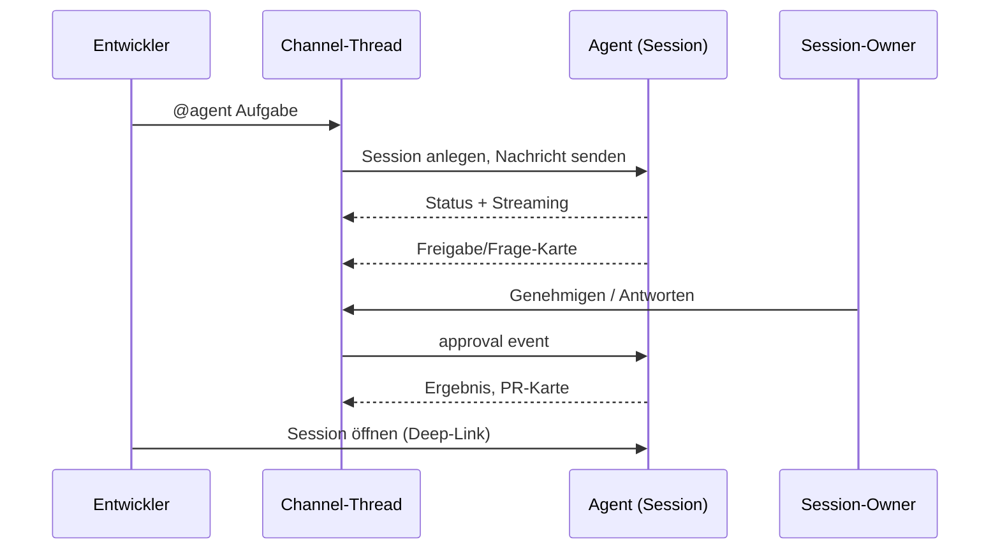

# Story Map: Omnigent Chat — v0.1 (2026-10-16, Status: Entwurf)

Ziel-Launch Release 1: Wochenende 24./25.10.2026 (Jens). Status je Story: exists / adapt / new (Basis: jholze/omnigent main 87f6f08 + PR #4).

## Rollen
| Rolle | Primäres Ziel | Lane |
|---|---|---|
| Entwickler (Teammitglied) | mit Kollegen und Agenten abstimmen, Arbeit anstoßen | 1 (primär) |
| Session-Owner / Tech Lead (z. B. Jens) | Agenten-Arbeit steuern, freigeben, Überblick behalten | 2 |
| Agent (Lead oder Worker) | Aufgaben aus dem Gespräch erledigen, bei Bedarf fragen | 3 |
| UX-Agent | Chat-Oberflächen gegen UX-Regeln prüfen | 3b (Bau-Rolle, nicht Produkt-Nutzer) |
| Admin | Server, Channels, Feature-Flag verwalten | 4 |
| Reviewer (Mensch) | PRs und Pläne prüfen, im Chat diskutieren | 5 |
| Externer Agent (Grok Bot via Omnigent-MCP) | als Teammitglied im Chat mitarbeiten, auf @ reagieren | 6 |

## Backbone
| A1 Ankommen & Überblick | | A2 Mit Menschen sprechen | | | A3 Agenten beauftragen | | | | A4 Auf Agenten reagieren | | A5 Code & Tickets | | | A6 Verwalten | |
|---|---|---|---|---|---|---|---|---|---|---|---|---|---|---|---|
| T1.1 Chat öffnen | T1.2 sehen, was mich braucht | T2.1 in Channel/DM schreiben | T2.2 im Thread antworten | T2.3 jemanden erwähnen | T3.1 Agent per @ rufen | T3.2 Fortschritt live sehen | T3.3 steuern (Steer/Stop/Retry) | T3.4 Ergebnis übernehmen | T4.1 Freigabe/Frage beantworten | T4.2 Plan prüfen | T5.1 PR im Chat sehen | T5.2 über Issue/PR diskutieren | T5.3 Issue aus Chat anlegen | T6.1 Channels & Mitglieder | T6.2 Agenten im Channel |

## Map (Stories nach Slice)

### R0 Walking Skeleton — Ergebnis: Ein Entwickler schreibt im Channel, ruft einen Agenten per @, sieht ihn im Thread arbeiten und gibt eine Freigabe direkt im Thread.
- ST-1.1.1 Als Entwickler öffne ich eine Chat-Ansicht mit Channel-Liste und DMs in der Sidebar. (new)
- ST-2.1.1 Als Entwickler schreibe ich in einen Channel; alle Mitglieder sehen es live. (adapt: session_chat_messages, SSE)
- ST-2.1.2 Als Entwickler schreibe ich eine DM an einen Kollegen. (new)
- ST-2.2.1 Als Entwickler antworte ich in einem Thread (eine Ebene). (new)
- ST-3.1.1 Als Entwickler rufe ich mit @agent einen Agenten; daraus entsteht ein Thread mit einer verlinkten Omnigent-Session im gleichen Projekt. (new, nutzt POST /v1/sessions + /events)
- ST-3.2.1 Als Entwickler sehe ich im Thread den Agent-Status (läuft, braucht Antwort, fertig, Fehler) und die Antwort gestreamt. (adapt: session.status, SessionStateBadge, AI Elements)
- ST-4.1.1 Als Session-Owner beantworte ich Freigaben und Fragen des Agenten direkt im Thread. (adapt: ApprovalCard, AskUserQuestionForm, POST /events type approval)
- ST-6.1.1 Als Admin aktiviere ich den Chat per Feature-Flag; es gibt einen Standard-Channel #general. (adapt: Flag aus enger Spec)

### R1 Launch (24./25.10.) — Ergebnis: Das Team kann einen Arbeitstag komplett im Omnigent-Chat verbringen, inklusive Agenten-Steuerung, und es sieht richtig gut aus.
- ST-1.2.1 Als Entwickler sehe ich Ungelesen-Zähler pro Channel/DM/Thread, serverseitig gespeichert und über Geräte synchron. (new)
- ST-1.2.2 Als Entwickler sehe ich eine „Braucht dich“-Ansicht: Erwähnungen und offene Agent-Fragen. (adapt: InboxPage, pending_elicitations_count)
- ST-1.2.3 Als Entwickler bekomme ich eine Desktop-Benachrichtigung bei Erwähnung, DM und Agent-Frage. (adapt: useIdleNotifications)
- ST-2.3.1 Als Entwickler erwähne ich Kollegen mit @ und Autovervollständigung. (new, Tiptap-Mention)
- ST-2.1.3 Als Entwickler diktiere ich Nachrichten per Mikrofon. (exists: ComposerMicButton, /dictation/stream)
- ST-2.1.4 Als Session-Teilnehmer habe ich zu jeder geteilten Session automatisch einen Session-Chat. (adapt: PR #4 als Sonderform eines Channels)
- ST-3.1.2 Als Entwickler lege ich fest, welcher Agent bzw. welche Agent-Konfiguration antwortet (@name). (new)
- ST-3.1.3 Als Entwickler schreibe ich im Agent-Thread weiter, ohne erneut @ zu tippen; der Agent folgt dem Thread, bis ich ihn entlasse. (new)
- ST-3.2.2 Als Entwickler sehe ich die Arbeitsschritte des Agenten (Tool-Aufrufe, Todos) eingeklappt im Thread. (adapt: AI Elements tool/task, session.todos)
- ST-3.3.1 Als Entwickler steuere ich nach (Nachricht während des Laufs), unterbreche oder starte neu, per Button oder Slash-Befehl. (adapt: interrupt/retry/steer über /events)
- ST-3.3.2 Als Session-Owner stoppe ich den Agenten. (exists: stop_session, Owner-only)
- ST-3.4.1 Als Entwickler öffne ich die volle Session aus dem Thread mit einem Klick. (new)
- ST-4.2.1 Als Session-Owner prüfe ich einen Plan des Agenten im Thread und gebe ihn frei. (adapt: ExitPlanModeReview)
- ST-5.1.1 Als Reviewer sehe ich eine PR-Karte im Thread (Status, CI, Diff-Link), sobald der Agent einen PR erzeugt. (adapt: resources/github/prs, PullRequestPanel)
- ST-7.1.1 Als Grok-Bot-Agent lese und schreibe ich über den Omnigent-MCP-Server in Channels, DMs und Threads, gekennzeichnet als externer Agent, mit den Rechten meines Owners. (new) [OFFEN: MCP-Details von MCP Smith]
- ST-7.1.2 Als Entwickler erwähne ich einen Grok-Bot-Agenten per @ und er wird aktiv geweckt und antwortet im Thread. (new) [OFFEN: Weck-Mechanismus]
- ST-7.1.4 Als Omnigent-Nutzer binde ich eigene Grok-Bot-Agenten an; jeder hat ein eigenes Agenten-Konto (Principal-Typ agent), gehört mir, hat nur Chat-Rechte und ist im Chat als "Name (Owner)" markiert. (new)
- ST-7.1.5 Als Grok-Bot-Agent spreche ich andere Grok Bots im Chat an; nach 5 Bot-zu-Bot-Antworten am Stück wartet der Thread auf einen Menschen. (new)
- ST-7.1.6 Chat-Tools im Omnigent-MCP-Server (Channels, DMs, Threads lesen/schreiben) und Mention-Event in der Webhook-Outbox. (new; Abhängigkeit PR #14, #15)
- ST-7.1.3 Als Entwickler sehe ich Grok-Bot-Agenten in der Mitglieder- und @-Liste mit Status. (new)
- ST-UX-1 Als Nutzer erlebe ich flüssige Animationen bei neuen Nachrichten, Statuswechseln, Karten und Ungelesen-Badges. (new: Motion, Muster aus agent-native)
- ST-UX-2 Der UX-Agent prüft jede Chat-Oberfläche vor dem Merge gegen die Regeln aus ux-ui-agent-skills. (new, Bau-Prozess)

### R2 — Ergebnis: GitHub-Arbeit und Team-Organisation laufen über den Chat.
- ST-5.2.1 Als Entwickler poste ich einen Issue- oder PR-Link und bekomme eine Live-Karte; wir diskutieren im Thread. (new)
- ST-5.2.2 Als Entwickler bitte ich einen Agenten im Thread, ein Issue zu kommentieren oder einen Review zu schreiben. (new, über GitHub-App als Nutzer)
- ST-5.3.1 Als Entwickler lege ich aus einer Chat-Nachricht ein GitHub-Issue an. (new)
- ST-3.2.3 Als Tech Lead sehe ich die Worker eines Lead-Agenten als Live-Liste im Thread. (adapt: child_sessions, SubagentsPanel)
- ST-6.1.2 Als Admin lege ich private Channels an und verwalte Mitglieder. (new)
- ST-6.2.1 Als Admin füge ich Agenten dauerhaft zu Channels hinzu. (new)
- ST-5.4.1 Als Entwickler öffne ich mit /board ein Kanban-Widget im Chat; Spalten aus GitHub-Projects-Status (Fallback Labels), Karten mit Titel, Labels, Assignee. (new; Basis: Canvas-Board, GitHub-App)
- ST-5.4.2 Als Entwickler verschiebe ich Tickets per Drag-and-drop oder Befehl ("#16 nach In Progress"); der Chat läuft weiter, die Änderung erscheint als Zeile im Channel. (new)
- ST-3.3.3 Server-seitige Nachrichten-Queue für Agenten. (adapt: Queue heute nur localStorage)

### Später
Reaktionen, Bearbeiten/Löschen, Dateien, Suche, Export, Mobile, Vorlesen/Sprachdialog (TTS), GitHub-Webhooks, Slack-Brücke.

## Rollen-Abdeckung je Slice
| Rolle | R0 | R1 | R2 | Zurückgestellt |
|---|---|---|---|---|
| Entwickler | schreiben, @agent, Status | Ungelesen, Erwähnungen, Diktat, Steer | GitHub-Karten | Suche, Dateien |
| Session-Owner | Freigaben | Stop, Plan-Freigabe | Worker-Liste | – |
| Agent | antwortet im Thread, fragt per Karte | folgt Thread, zeigt Schritte | kommentiert Issues | Agent-zu-Agent im Chat |
| Admin | Flag, #general | – | private Channels, Agenten verwalten | Moderation |
| Reviewer | – | PR-Karte | Diskussion an Issue/PR | Review im Chat |

## Übergaben (Hand-offs)

## Annahmen
- [ANNAHME] A-5 Wer den Agenten per @ ruft, wird Owner der entstehenden Session; alle Channel-Mitglieder bekommen Lesen.
- [ANNAHME] A-6 Der Agent bekommt als Kontext die auslösende Nachricht und den Thread, nicht den ganzen Channel.
- [ANNAHME] A-7 Eine Server-Instanz reicht für den Launch (In-Process-Echtzeit).

## Offene Fragen
| ID | Frage | Vorschlag | Blockiert |
|---|---|---|---|
| Q-8 | ENTSCHIEDEN: Aufrufer plus alle mit EDIT auf der Session beantworten Freigaben | – | – |
| Q-9 | ENTSCHIEDEN: Channel-Mitglieder bekommen Lesen, nicht Bearbeiten | – | – |
| Q-10 | Reicht der Schnitt R0/R1 für den Termin, oder müssen GitHub-Karten zum Diskutieren schon in R1? | R1 nur PR-Karte, Diskussion in R2 | Stufe 7 |
| Q-11 | Ist R0 ein interner Zwischenstand (z. B. Mittwoch) zum Ausprobieren? | Ja, Demo Mitte der Woche | Stufe 7 |

## Changelog
- v0.3 (2026-10-16) Rechtefragen entschieden; Agenten-Konten, Bot-zu-Bot mit Bremse, MCP-Chat-Tools; Abhängigkeiten #14/#15 und Server aus Fork.
- v0.2 (2026-10-16) Grok-Bot-Agenten als Rolle, komplett in R1 (Jens); Board-Widget in R2 (Vorschlag).
- v0.1 (2026-10-16) Erster Entwurf nach Code-Analyse (Elicitation, Status, Steuerung, Diktat, GitHub, Slack-Integration).
